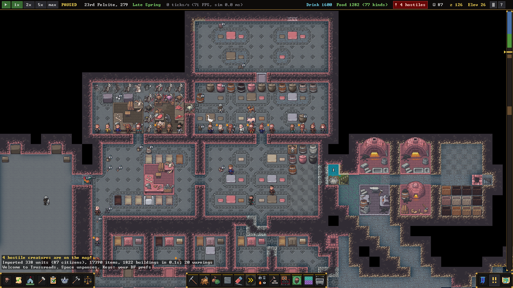
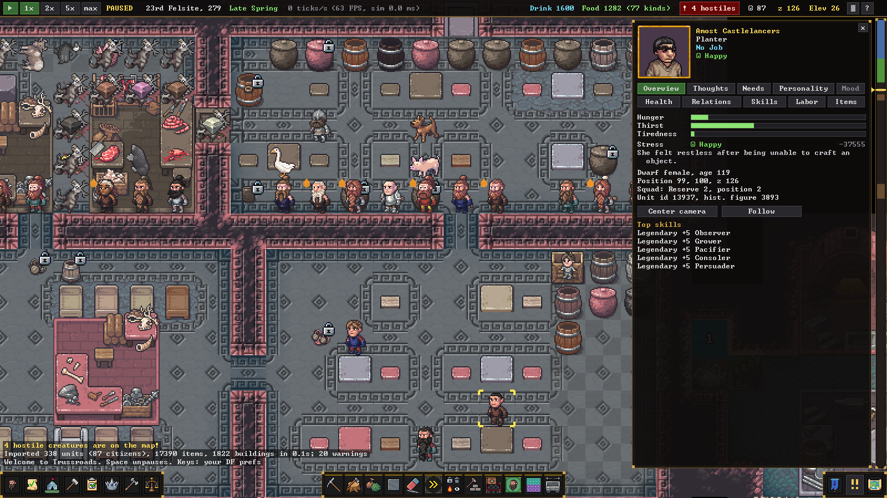
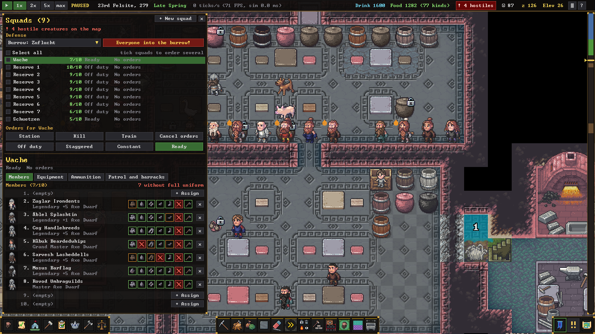
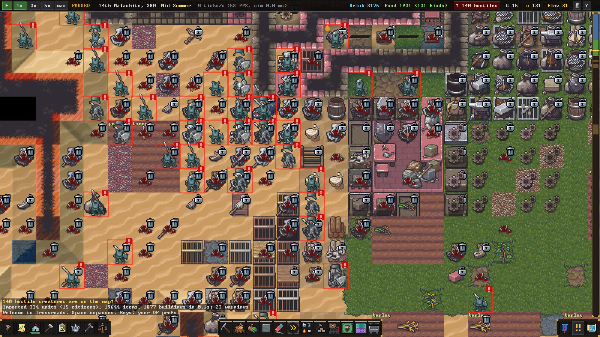

# Rustfort

A fast, faithful re-implementation of Dwarf Fortress fortress mode in Rust that continues your own DF fort.

**Status:** v0.12, alpha. Tested on Windows 11 (Windows 10 should work). Linux builds are untested.

> **Legal note.** Rustfort is an unofficial fan project. It is not affiliated with or endorsed by
> Bay 12 Games or Kitfox Games. You need your own copy of Dwarf Fortress: the Steam edition,
> v50 or newer, which includes the Premium graphics. This repository contains no Dwarf Fortress
> code, graphics or raws. Rustfort reads everything it needs from your installation at runtime.
> Dwarf Fortress is a trademark of Bay 12 Games. The name is used here only to say which game
> Rustfort works with.

Rustfort copies a fort from your running Dwarf Fortress through a read-only DFHack script and
then simulates it on its own. The rules come from the Dwarf Fortress Wiki and from observing the
real game, and the simulation is deterministic. It stays fast with hundreds of dwarves, where DF
itself slows down sharply. The game window looks and plays like Steam DF: Premium sprites from
your install, the mouse-driven interface, and your own key bindings.



## Install with an AI assistant

Paste this into a coding agent (Claude Code, Codex, Cursor, ...) on the computer where Dwarf
Fortress is installed:

```text
Install and start Rustfort (https://github.com/GordonMohrin/rustfort) on this computer.
Follow docs/INSTALL.md from that repository step by step and check each step as it describes.
Ask me before you install any software or change any settings.
Never modify my Dwarf Fortress installation or my DF saves.
At the end, start Rustfort normally and report what worked and what did not.
```

## Install manually

On Windows 10/11, with Dwarf Fortress installed from Steam. Skip any prerequisite you already
have, and open a new terminal after installing them:

```powershell
winget install --id Git.Git -e
winget install --id Microsoft.VisualStudio.2022.BuildTools -e --override "--add Microsoft.VisualStudio.Workload.VCTools --includeRecommended --passive"
winget install --id Rustlang.Rustup -e
```

Then build and start Rustfort:

```powershell
rustup default stable-msvc
git clone https://github.com/GordonMohrin/rustfort.git
cd rustfort
cargo build --release -p rf-app     # the first build takes several minutes
target\release\rustfort.exe
```

Later you can just run `rustfort.cmd` in the repository folder. It rebuilds what changed and
then starts the game. Rustfort finds a Steam install of Dwarf Fortress by itself. You can also
set the folder in the title screen's Settings or with the `RUSTFORT_DF_DIR` environment
variable. [docs/INSTALL.md](docs/INSTALL.md) explains every step, how to check it and what to do
when it fails, and has a best-effort Linux section.

## Play your own fort

1. Install [DFHack](https://dfhack.org). It is free, and on Steam it is a separate app
   ("DFHack") that installs into the DF folder.
2. Start Dwarf Fortress and load your fort. It can keep running.
3. In Rustfort's title screen choose **Import from Dwarf Fortress**, then **Import and play**.

The exporter only reads from DF. It never pauses the game or writes to it, and a large fort
takes about a minute. Each import goes to its own folder, `export/<fort>-<timestamp>/`, and
**Continue** finds it afterwards. Without an import, Rustfort can start a small synthetic test
fort (**Built-in test fort**). To export by hand, see [docs/INSTALL.md](docs/INSTALL.md) and
[tools/dfhack/README.md](tools/dfhack/README.md).

The DFHack scripts were developed against DF 53.16 with DFHack 53.16-r2.

## Screenshots

| | |
|---|---|
|  |  |
| Unit sheet with the portrait, needs, stress and skills | Military side panel with the "Everyone into the burrow!" button and each member's equipment |
|  |  |
| The siege that ended the reference fort in DF, continued in Rustfort | The main level of the reference fort |

The screenshots show Dwarf Fortress's Premium graphics, which Rustfort reads from the player's
own installation at runtime. The graphics belong to Bay 12 Games and Kitfox Games and are not
part of this repository's license.

## Features

What v0.1 to v0.12 added, in short. [PROGRESS.md](PROGRESS.md) has the full history, and
[docs/FIDELITY.md](docs/FIDELITY.md) rates each rule against the DF v50 wiki.

- **Import:** the read-only DFHack exporter copies the whole map (every z-level, materials,
  liquids, constructions, engravings) and every unit with its body, wounds, skills, attributes,
  personality, needs, thoughts and relationships. It also copies items with their containers,
  buildings with their states and lever links, stockpile settings, zones, burrows, squads with
  uniforms and ammunition, work orders, work details, kitchen settings, locations, justice
  cases, nobles, civilizations, difficulty settings, wealth and invasion history.
- **Daily life:** DF's time base, hunger, thirst and sleep timers, and gait speeds. Pathfinding
  uses traffic costs and constant-time reachability checks. Dwarves dig, channel, fell trees,
  gather plants and haul goods using bins, barrels and wheelbarrows.
- **Production:** workshops and furnaces, farming, brewing and cooking, and work orders with
  their conditions. Metallurgy covers smelting, alloys, steel and coke. There are also glass,
  pottery, the ashery, soap, constructions, smoothing and engraving. Item quality uses the
  wiki's skill formula.
- **Psychology:** about 240 DF thought types, emotions, short- and long-term stress, needs and
  focus, personality, and room value. Breakdowns (tantrums, depression, obliviousness) can
  happen, and so can strange moods that produce artifacts.
- **Society:** migrant waves follow DF's rules. Dwarves are born, grow old and are buried, and
  unburied ones come back as ghosts. Caravans come to barter. Nobles, elections and mandates
  work, as do temples, taverns and libraries, visitors and petitions, and justice.
- **War:** combat runs through tissue layers using the wiki's material science, with wounds,
  bleeding and medical care. Crossbows and bows work, and squads have routines, orders and
  uniforms. Civilian alerts work. Sieges are sized by DF's invasion tiers. Ambushes, thieves,
  snatchers, forgotten beasts and mounted or climbing invaders all appear.
- **Defenses and machines:** locked doors, drawbridges, levers and traps. Ballistas, catapults
  and bolt throwers can be built. Screw pumps, water wheels and windmills run on axles and
  gears. Minecarts follow hauling routes.
- **Physics and animals:** fluids flow under pressure and evaporate, leaving mud. Aquifers seep
  and magma meeting water makes obsidian. Unsupported ground caves in. Animals graze, breed,
  lay eggs, give milk and wool, and can be trained, hunted, fished or slaughtered.
- **Game window:** DF Premium sprites from your install: layered dwarves in their real
  equipment, portraits, seasonal trees and engravings. Steam DF's screens are there, including
  creatures, unit sheets, work orders, labor and work details, stockpile editor, squads, trade,
  nobles, places, justice, hauling routes, tasks and reports. Your own DF key bindings and
  announcement settings apply. Other parts: title screen, autosave, save and load, and a crash
  guard with rescue saves.
- **Determinism and saves:** the same seed gives the same state hash with 1 thread and with
  many. Saving, loading and playing on gives a bit-identical result, and newer builds load
  older saves.

**Known gaps:** no temperature, and invaders do not dig. Craft quality is still below DF's
because unit preferences are not exported. Minecarts have no collisions. There is no adventure
mode, Legends or deep world history.

## Performance

Rustfort against Dwarf Fortress on **the same fort and the same PC** (6-core Ryzen 5 5600X,
Windows 11). DF numbers are from DF 53.16 (Steam) with DFHack, measured while the reference fort
was played; Rustfort numbers are from v0.12 on that fort's DFHack exports. One tick is one DF
simulation step; a game year is 403,200 ticks. DF at "normal" speed is capped at 100 ticks/s.

| scenario | Dwarf Fortress | Rustfort | faster by |
|---|---|---|---|
| everyday fort life: about 90 citizens, about 330 units, 17,000 items, 192x192x150 tiles | about **170** ticks/s (FPS cap raised to 500) | about **100,000** ticks/s headless; **66,000-90,000** ticks/s in the game window at "max" | about 400-600x |
| the siege that ended the fort: about 140 goblins, 330-390 active units | about **29** ticks/s (DF's FPS counter: 4-60) | about **51,000** ticks/s headless | about 1,700x |
| a forced 133-goblin siege, heaviest fighting (472 units) | not measured | **15,000-33,000** ticks/s headless | |
| the same fort with 400 extra citizens (487 citizens, 748 units) | not measured | about **38,000** ticks/s headless | |
| one game year of everyday fort life | about **40 minutes** | about **4 seconds** headless, about 5-6 s in the game window | |

How it was measured:

- DF: the calendar advance per wall-clock second while the game ran (see
  [docs/VALIDATION.md](docs/VALIDATION.md) and [tools/dfhack/README.md](tools/dfhack/README.md)).
  DFHack and the player's automation scripts were running, as in normal play.
- Rustfort headless: `rustfort.exe bench --ticks 806400 --standdown` (2 game years in about 8 s)
  and `bench --export <siege export> --ticks 40320`; the 487-citizen row is
  `cargo run -p rf-sim --release --example scale -- --extra 400`, the forced siege
  `--example siegeperf -- --standdown`.
- Rustfort in the game window: `--speed max` with the Premium graphics drawn at 60-75 FPS; the
  simulation runs on its own thread. The lower figure includes the pauses for pop-up
  announcements.

The *reference fort* is the DF fort used to develop and validate Rustfort: Trussroads (native
name Tileshtulon) in the world Zilirróth. Its exports are not distributed.

## Controls

The defaults are Steam DF's, and your own DF `interface.txt` overrides them. **Space** pauses
and resumes, **1 2 3 4** set the speed, the **mouse wheel** changes the z-level, **Ctrl+wheel**
zooms, and middle-drag or **WASD** pans. Left-click opens info and right-click or **Esc** backs
out. **F1** shows every key, **F5** saves, and **Esc** opens the menu. The full list, and every
screen, is in [crates/rf-app/README.md](crates/rf-app/README.md).

## Headless tools

```powershell
target\release\rustfort.exe bench --ticks 806400 --standdown   # ticks/s, phase times and the state hash
target\release\rustfort.exe savebench                          # save and load time and size
cargo run -p rf-sim --release --example validate -- --from <older export> --to <newer export>   # compare with real DF
cargo run -p rf-sim --release --example chaos -- --seeds 1-8 --years 2                          # crash hunting
cargo run -p rf-sim --release --example saveload -- --n 20000 --m 20000                         # save/load continuation
```

Without `--export DIR` these tools pick a fort the same way the game does: `RUSTFORT_EXPORT`,
then the newest export in `export/`, else the built-in synthetic fort. `validate` always takes
two exports of the same fort ([docs/VALIDATION.md](docs/VALIDATION.md)).

## Project layout

| path | contents |
|---|---|
| `crates/rf-core` | data model (world, tiles, units, items, buildings, ...), shared by all crates |
| `crates/rf-raws` | DF raw-file parser and DF install lookup |
| `crates/rf-gfx` | Premium sprites, read at runtime from the DF install |
| `crates/rf-import` | reader for the exporter's fort export |
| `crates/rf-sim` | deterministic simulation |
| `crates/rf-app` | game window and CLI (`rustfort.exe`) |
| `crates/rf-save-v09` | frozen layout of v0.9 saves, for converting old saves |
| `tools/dfhack` | read-only DFHack scripts: exporter, probe, verifier |
| `rustfort.cmd` | Windows launcher: build if needed, then start |

At runtime Rustfort writes only inside its working directory: `saves/` (saves, settings,
crash log) and `export/` (fort exports). Both are gitignored.

## Documentation

- [VISION.md](VISION.md): goals, principles, fidelity tiers, milestones
- [PROGRESS.md](PROGRESS.md): version history and known gaps
- [docs/INSTALL.md](docs/INSTALL.md): installation, import, updating, troubleshooting
- [docs/ARCHITECTURE.md](docs/ARCHITECTURE.md): crates and working rules
- [docs/FIDELITY.md](docs/FIDELITY.md): every simulation rule checked against the DF wiki
- [docs/VALIDATION.md](docs/VALIDATION.md): Rustfort against real DF history
- [docs/EXPORT_FORMAT.md](docs/EXPORT_FORMAT.md): the fort export format
- [docs/SAVES.md](docs/SAVES.md): save file format and exact continuation
- [crates/rf-app/README.md](crates/rf-app/README.md): the game window, screens and controls
- [crates/rf-gfx/README.md](crates/rf-gfx/README.md): how the Premium sprites are chosen
- [tools/dfhack/README.md](tools/dfhack/README.md): the DFHack exporter
- [CONTRIBUTING.md](CONTRIBUTING.md): how to contribute

## Contributing

Bug reports and pull requests are welcome. Please read [CONTRIBUTING.md](CONTRIBUTING.md) first.
The most important rules are clean-room work (the wiki and observation, never decompiling), no
DF files in the repository, and an unchanged state hash with one thread and many.

## License

Licensed under either of

- Apache License, Version 2.0 ([LICENSE-APACHE](LICENSE-APACHE))
- MIT license ([LICENSE-MIT](LICENSE-MIT))

at your option. Unless you explicitly state otherwise, any contribution intentionally submitted
for inclusion in the work by you, as defined in the Apache-2.0 license, shall be dual licensed
as above, without any additional terms or conditions.

The license covers Rustfort's own code and documentation only. Dwarf Fortress, its data,
graphics and raws are not covered by it and are not part of this repository.

## Acknowledgements

- **Bay 12 Games** (Tarn and Zach Adams) for Dwarf Fortress.
- **Kitfox Games** for publishing the Steam edition with its Premium graphics.
- **The DFHack team** for DFHack, which makes the read-only export possible.
- **The Dwarf Fortress Wiki** and its editors. Its documentation of DF's rules is the
  clean-room specification of this project.
